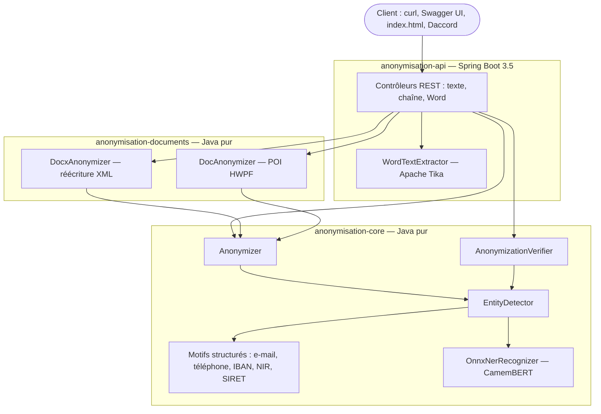
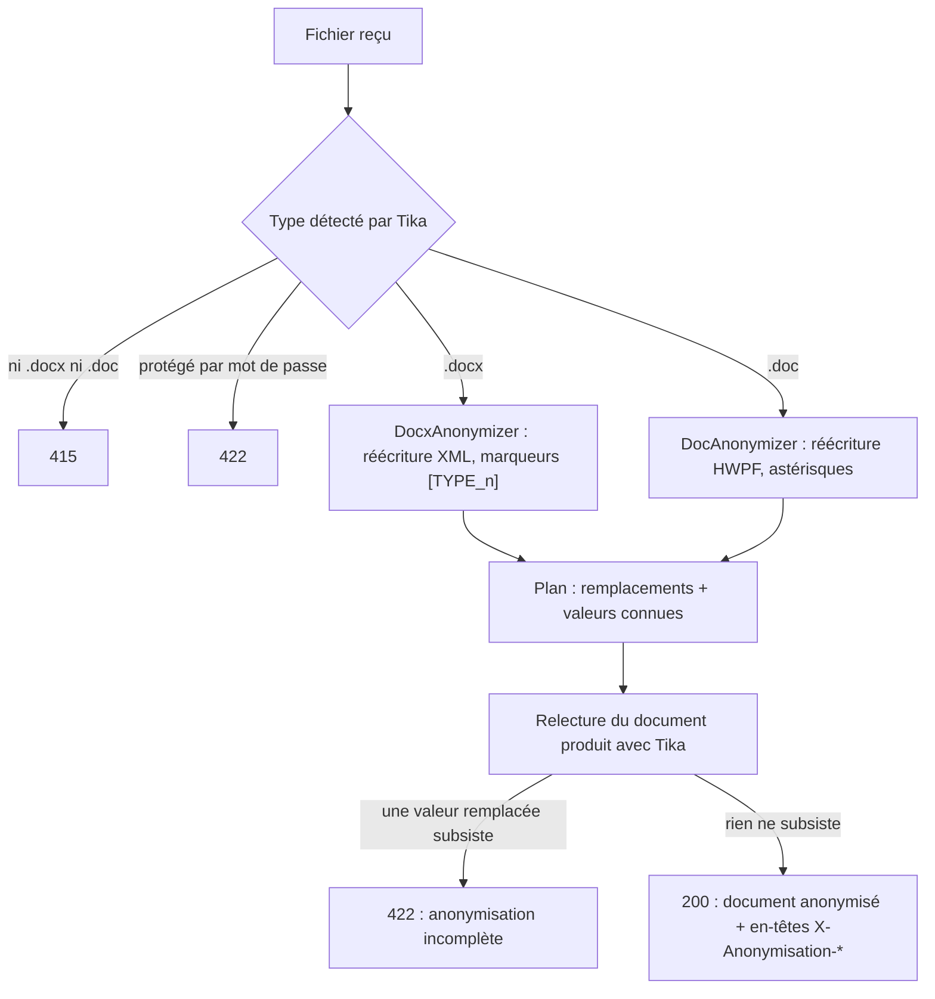

# POC anonymisation — Documentation de la V0

| | |
|---|---|
| **Version** | V0, `0.1.0-SNAPSHOT` |
| **Emplacement** | dépôt `daccord-poc`, dossier `anonymisation/2026-11-18-ner-and-regex` (EXP-01) |
| **Commits** | `2478713` « ajouter la version zéro du POC d'anonymisation » (16/11/2026) ; `20dff68` « ui user friendly » (19/11/2026), qui ajoute la page de test |
| **Statut** | Preuve de concept. Qualité de détection **non mesurée** sur de vrais documents, **non intégrée** à Daccord. |
| **Complète** | le [README](../README.md), qui reste le guide de démarrage rapide |

Ce document décrit ce que fait la V0, comment elle le fait, pourquoi elle est faite ainsi, ce qu'elle ne sait pas faire, et ce qu'il reste à établir avant de décider de la suite. Tout ce qui est affirmé ici a été relu dans le code ; les chiffres de performance sont ceux du README (non rejoués pour cette rédaction) et sont signalés comme tels.

## Sommaire

1. [En bref](#1-en-bref)
2. [Contexte et objectif](#2-contexte-et-objectif)
3. [Périmètre de la V0](#3-périmètre-de-la-v0)
4. [Architecture](#4-architecture)
5. [Fonctionnement détaillé](#5-fonctionnement-détaillé)
6. [API](#6-api)
7. [Installation, configuration, exploitation](#7-installation-configuration-exploitation)
8. [Tests et état du build](#8-tests-et-état-du-build)
9. [Performances et ressources](#9-performances-et-ressources)
10. [Limites connues](#10-limites-connues)
11. [Décisions de conception](#11-décisions-de-conception)
12. [Comparaison avec l'existant Daccord et intégration](#12-comparaison-avec-lexistant-daccord-et-intégration)
13. [Historique et suite](#13-historique-et-suite)

---

## 1. En bref

La V0 est un service Java 21 (Spring Boot) qui **anonymise** un texte ou un document Word, et qui **vérifie** qu'un texte ou un document Word est bien anonymisé.

- **Détection hybride** : un modèle de reconnaissance d'entités nommées (NER) CamemBERT, exécuté *dans la JVM* via ONNX Runtime, pour les noms de personnes, lieux et organisations ; des motifs structurés validés par clé de contrôle pour les e-mails, téléphones, IBAN, NIR et SIRET.
- **Six services REST** : {fichier texte, chaîne JSON, document Word} × {anonymiser, vérifier}.
- **Un moteur réutilisable** : le module `core` est en Java pur, sans Spring, et pourrait être embarqué tel quel dans Daccord.
- **Pas de PDF, pas d'OCR.**

**Ce que la V0 ne prouve pas encore** : à quel point elle repère bien les données personnelles des vrais accords. Les essais ont porté sur des phrases et des documents fictifs écrits à la main. C'est l'objet de l'étape suivante (voir [§13](#13-historique-et-suite)).

## 2. Contexte et objectif

La V0 est le point de départ du **POC 1 « Anonymisation »** du plan d'action *POC IA DACCORD* (cible : service fin T1 2027). L'objectif du POC est de **remplacer la brique CEA** qui contrôle aujourd'hui l'anonymisation des accords déposés, en deux étapes :

1. **Vérifier** : détecter les données personnelles résiduelles d'un texte censé être anonymisé, et produire un rapport.
2. **Anonymiser** : masquer ou pseudonymiser automatiquement les entités détectées, l'agent gardant la main.

Données ciblées par le plan : noms et prénoms de personnes physiques, signataires, adresses, téléphones, e-mails, NIR, identifiants divers. Le sort des raisons sociales et des mentions légales utiles à la publication reste à cadrer avec l'équipe produit.

La méthode du plan est « **V0 rapide, puis mesurer, puis itérer** » : la V0 sert de point de comparaison, chaque évolution garde son score, et le rendement (gain de score par rapport au temps investi) décide de la suite.

La V0 couvre **les deux étapes** du plan et va au-delà pour le format (réécriture de documents Word). Elle ne couvre pas encore la mesure.

## 3. Périmètre de la V0

| Dans la V0 | Hors V0 |
|---|---|
| Détection de personnes, lieux, organisations (NER) | Adresses postales complètes (la voie est masquée, pas le numéro) |
| Détection d'e-mails, téléphones, IBAN, NIR, SIRET (motifs + clés de contrôle) | Sigles d'administration (« DREETS »), fonctions, dates, situations rares (quasi-identifiants) |
| Anonymisation de texte brut (UTF-8), de chaînes JSON, de `.docx`, de `.doc` | PDF, `.docm`, `.rtf`, `.odt` |
| Vérification de texte, de chaînes, de `.docx` et `.doc`, avec ou sans original | OCR : le texte d'une image n'est vu ni à l'anonymisation ni à la vérification |
| API REST synchrone, Swagger UI, page de test `index.html` | Authentification, TLS, quotas, traitement asynchrone, conteneurisation |
| Tests automatisés (voir [§8](#8-tests-et-état-du-build)) | Mesure de qualité sur corpus réel ; comparaison avec la brique CEA |
| | Score global de confiance (le plan évoque « un rapport + un score » : la V0 rend un verdict binaire et un score **par reste détecté**) |
| | Intégration dans Daccord |

## 4. Architecture

### 4.1 Modules



| Module (`artifactId`) | Rôle | Dépendances principales |
|---|---|---|
| `core` | Détection, anonymisation, vérification. **Aucune dépendance à Spring.** | DJL HuggingFace tokenizers 0.40.0, ONNX Runtime 1.32.0, Jackson, SLF4J |
| `documents` | Réécriture des `.docx` (XML) et `.doc` (HWPF). Pas de Spring ; Tika seulement en test. | `core`, Apache POI scratchpad 5.4.1 |
| `api` | REST, configuration, lecture des documents avec Tika, page de test, Swagger UI. | `core`, `documents`, Spring Boot 3.5.16, springdoc 2.8.17, Apache Tika 3.2.3 |

`groupId` : `fr.gouv.travail.anonymisation` ; paquets Java `fr.gouv.travail.anonymisation.{core,documents,api}`.

### 4.2 Principe directeur

**Un seul `EntityDetector` sert à anonymiser et à vérifier.** Ce que le service s'engage à masquer est exactement ce qu'il contrôle ensuite : il n'existe pas deux définitions de « donnée personnelle » qui pourraient diverger.

## 5. Fonctionnement détaillé

### 5.1 Types d'entités

| Type | Source | Règle |
|---|---|---|
| `PERSONNE` | NER (`PER`) | |
| `LIEU` | NER (`LOC`) | |
| `ORGANISATION` | NER (`ORG`) | |
| `DIVERS` | NER (`MISC`) | **Désactivé par défaut** : trop bruyant (événements, œuvres, nationalités…) |
| `EMAIL` | motif | lettres accentuées tolérées ; le point final d'une phrase n'en fait pas partie |
| `TELEPHONE` | motif | `0X XX XX XX XX`, `+33` ou `0033` ; séparateurs espace, point, tiret |
| `IBAN` | motif + clé | reste de la division par 97 égal à 1. Clé invalide : **retenu quand même** (score 0,6), car mieux vaut signaler un numéro mal saisi que le laisser passer |
| `NIR` | motif + clé | 15 chiffres, `2A`/`2B` pour la Corse ; clé = 97 − (nombre mod 97). Clé invalide : retenu (score 0,6) |
| `SIRET` | motif + Luhn | 14 chiffres en groupes 3-3-3-5. Luhn invalide : **écarté** (score 0) |

Les identifiants structurés tolèrent une coupure en fin de ligne (« 06 12 34 56 ⏎78 »), fréquente dans un texte extrait d'un PDF.

### 5.2 Chaîne de détection (`EntityDetector`)

Les moteurs sont exécutés **dans l'ordre** : `regex-email`, `regex-iban`, `regex-nir`, `regex-siret`, `regex-telephone`, puis `onnx-ner`. Pour chaque moteur :

1. les candidats dont le type n'est pas dans `anonymisation.types` ou dont le score est sous `anonymisation.min-score` sont écartés ;
2. les candidats restants sont triés par score décroissant, puis par longueur décroissante ;
3. un candidat est accepté s'il ne chevauche aucune entité déjà acceptée.

**Conséquence** : un motif validé (un IBAN) l'emporte toujours sur une entité NER qui le recouvre. Le résultat est une liste sans chevauchement, triée par position.

Les noms des moteurs utilisés sont renvoyés dans chaque réponse (`engines`).

### 5.3 Le NER dans la JVM (`OnnxNerRecognizer`)

```
texte ──► découpage en morceaux (≤ 1 200 caractères, ≤ 512 tokens)
      ──► tokenizer HuggingFace (DJL, bibliothèque native livrée dans le jar)
      ──► ONNX Runtime (CamemBERT exporté en ONNX)
      ──► un label par token (PER / LOC / ORG / MISC)  ──► entités avec offsets dans le texte d'origine
```

- **Modèle** : `Xenova/camembert-ner` (export ONNX de `Jean-Baptiste/camembert-ner`, licence MIT, entraîné sur WikiNER-fr, c'est-à-dire Wikipédia). Fichiers attendus dans le répertoire du modèle : `tokenizer.json`, `config.json` (pour `id2label`), `onnx/model.onnx` (440 Mo). Tout modèle HuggingFace de classification de tokens au même format peut le remplacer.
- **Découpage** (`TextChunker`) : un texte long est coupé en morceaux de `max-chunk-chars` (1 200) au plus, à l'endroit où un nom propre a le moins de chances d'être scindé. Ordre de préférence : ligne blanche, saut de ligne qui suit une fin de phrase, fin de phrase, saut de ligne quelconque, espace. Un saut de ligne ordinaire est une mauvaise coupure : dans un texte extrait d'un PDF, chaque ligne se termine ainsi, parfois entre le prénom et le nom (défaut constaté : « Fatima » restait en clair). Si un morceau dépasse 512 tokens (texte dense en chiffres), il est recoupé en deux.
- **Décodage** (`NerDecoder`) : les prédictions par sous-mot sont regroupées en entités ; un préfixe `B-` ouvre une nouvelle entité ; le score d'une entité est la **moyenne des probabilités** de ses tokens. Une apostrophe ou un trait d'union collé entre deux tokens de même type est rattaché à l'entité, quoi qu'en dise le modèle (il classe souvent le « ' » de « Caisse d'Allocations Familiales » hors entité, ce qui coupait l'organisation en deux).
- **Concurrence** : l'encodage du tokenizer natif est sérialisé (`synchronized`), car il n'est pas documenté comme thread-safe ; le coût est négligeable devant l'inférence.

Le NER n'est **pas fourni par Spring** : Spring ne sert que d'ossature à l'API.

### 5.4 Anonymisation (`Anonymizer`)

Chaque entité est remplacée par un marqueur `[TYPE_n]` (par exemple `[PERSONNE_1]`, `[EMAIL_2]`).

1. Le document est vu comme une liste de **fragments** (paragraphes, parties d'un fichier…). La détection porte sur l'ensemble, fragments joints par `\n`, pour que le NER garde le contexte des paragraphes voisins.
2. Les entités sont ramenées aux coordonnées de leur fragment ; une entité à cheval sur deux fragments est coupée en autant de morceaux.
3. Toutes les valeurs détectées sont mémorisées (`KnownValues`).
4. Dans chaque fragment, les valeurs mémorisées sont **recherchées partout ailleurs** et remplacées elles aussi (voir ci-dessous).
5. Le numéro d'un marqueur est attribué **par type et par valeur normalisée** : « Jean-Pierre », « jean pierre » et « JEAN‑PIERRE » reçoivent le même numéro.

Le résultat intermédiaire est un **`AnonymizationPlan`** : pour chaque fragment, la liste des remplacements (début, fin, type, marqueur), plus le décompte par type, les moteurs et les valeurs connues. Le plan ne touche à aucun fichier : chaque format (texte, `.docx`, `.doc`) l'applique à sa propre structure.

**Propagation des valeurs connues.** Un nom que le NER a vu dans neuf phrases sur dix doit aussi disparaître de la dixième. La recherche ignore la casse, les accents et la mise en forme des espaces, et ne retient que des **mots entiers**. Garde-fous :

- les valeurs de **moins de 3 caractères** ne sont pas propagées ;
- pour `PERSONNE`, `LIEU`, `ORGANISATION` (et `DIVERS`), une occurrence **qui commence par une minuscule est écartée** : un faux positif du NER sur « Pour » en début de phrase n'efface pas tous les « pour » du document ;
- pour les identifiants structurés (e-mail, téléphone, IBAN, NIR, SIRET), une correspondance exacte est toujours sûre, quelle que soit la casse ;
- à position égale, la valeur la plus longue l'emporte (« Marie Dupont » avant « Marie ») ;
- les marqueurs déjà présents ne comptent pas comme des valeurs (le mot « PERSONNE » dans `[PERSONNE_1]`) : **ré-anonymiser un texte déjà anonymisé ne change rien**.

La propagation porte sur la valeur *entière* détectée : si « Jean Dupont » est repéré, un « Dupont » isolé ailleurs n'est remplacé que si le NER le repère lui-même.

**Pseudonymisation, pas anonymisation.** Au sens du RGPD, le texte reste pseudonymisé tant qu'il contient des quasi-identifiants (fonction, date, situation rare) que ni le NER ni les motifs ne voient.

### 5.5 Vérification (`AnonymizationVerifier`)

Deux contrôles complémentaires, qui se cumulent quand l'original est fourni.

**Sans original — restes d'entités.** On relance la détection sur le texte « anonymisé » ; tout ce qui est encore repéré est un `RESIDUAL_ENTITY`. Deux subtilités :

- le NER reçoit le texte **marqueurs compris** : les remplacer par des espaces lui fait perdre le contexte, et il prend alors pour une personne un mot comme « Délégué » ;
- le modèle reconnaît les marqueurs eux-mêmes comme des noms (c'est ce qu'ils représentent) : on écarte la part commune avec un marqueur. Une valeur oubliée juste à côté d'un marqueur, que le modèle aurait fondue avec lui dans une même entité, reste signalée.

**Avec original — fuites de valeurs.** On détecte les entités de l'original, puis on cherche chacune dans le texte anonymisé (sans casse ni accents, mots entiers, valeurs d'au moins 3 caractères). Une valeur retrouvée est un `ORIGINAL_VALUE_LEAK`. Quand « Marie » et « Marie Dupont » sont toutes deux cherchées, seule la plus longue est gardée. **C'est le contrôle le plus fiable** : il ne dépend pas du rappel du modèle sur le texte anonymisé. Un reste déjà couvert par une fuite n'est pas compté deux fois.

**Verdict.** `CONFORME` si aucun reste, `NON_CONFORME` sinon. Si aucun moteur NER n'est actif, le rapport porte un avertissement explicite : un « conforme » sans NER ne couvre ni les noms, ni les lieux, ni les organisations.

> Un `CONFORME` signifie « rien trouvé par ces moteurs », pas « zéro donnée personnelle ».

### 5.6 Documents Word

Le type est reconnu **sur le contenu** par Tika ; ni l'extension ni le `Content-Type` annoncé ne comptent. Un document Office chiffré est refusé (422).



#### `.docx` — réécriture XML (`DocxAnonymizer`)

Le fichier est un zip lu en mémoire (avec bornes anti « bombe de décompression » : 10 000 parties, 200 Mo par partie, 500 Mo au total). **Ce qui n'est pas du texte est recopié octet pour octet** ; seules les parties modifiées sont réécrites. Aucune bibliothèque de mise en page n'intervient.

| Traité | Traitement |
|---|---|
| Paragraphes du corps, tableaux, zones de texte, en-têtes, pieds de page, notes, commentaires | analysés et réécrits |
| Texte DrawingML (formes, graphiques), valeurs de graphiques | analysés et réécrits |
| Codes de champ (`instrText`, par exemple un lien `mailto:`) | analysés et réécrits |
| Textes alternatifs des images, info-bulles | analysés et réécrits |
| Données personnalisées liées aux contrôles de contenu (`customXml`) | analysées et réécrites |
| Propriétés du document : titre, sujet, description, mots-clés… | analysées et réécrites |
| Propriétés qui désignent une personne : créateur, dernier auteur, société, responsable | **vidées d'office** |
| Auteurs et initiales des commentaires et révisions | remplacés par « Anonyme » / vidés |
| Liens externes qui contiennent une donnée | remplacés par `about:blank` (un marqueur casserait le lien) |
| Vignette, signatures numériques | **retirées** (toute modification invalide une signature, et elle nomme le signataire) |

Un nom coupé en plusieurs *runs* (« Jean » en gras puis « Dupont ») est retrouvé : le texte du paragraphe est reconstitué, l'entité y est repérée, puis remplacée dans le premier run concerné en retirant ce qu'elle occupait dans les suivants. Le marqueur prend donc la mise en forme du premier run. Le texte supprimé d'une révision est séparé du texte vivant (sinon « Dupont » supprimé puis « Ajouté » inséré se liraient « DupontAjouté »).

Le corps (`word/document.xml`) est traité en premier : la numérotation des marqueurs suit ainsi l'ordre de lecture. Le XML est lu avec les protections usuelles (traitement sécurisé, **DTD refusée**).

*Non traités* : texte des images, objets incorporés, classeurs liés à un graphique.

#### `.doc` — réécriture à longueur constante (`DocAnonymizer`)

Réécriture avec HWPF, **en remplaçant chaque caractère d'une valeur par une astérisque : la longueur du texte ne change jamais.** C'est un choix délibéré (voir [§11](#11-décisions-de-conception)) : le format binaire garde des tables de positions (limites entre en-tête et pied de page, notes, champs, signets) que HWPF ne met pas à jour quand on insère un texte de longueur différente.

Conséquences :

- **pas de marqueurs numérotés** dans un `.doc` : on ne distingue pas deux personnes entre elles ;
- chaque zone (corps, notes, en-têtes et pieds de page, commentaires, zones de texte) est analysée ;
- les zones de texte d'en-tête et de pied de page, que HWPF n'atteint pas, sont **analysées seulement** : si l'une contient une donnée, le document est refusé (422) et il faut le convertir en `.docx` ;
- créateur, dernier auteur, société, responsable et vignette sont effacés ; titre, sujet, mots-clés et commentaires sont anonymisés **avec un marqueur** `[TYPE_n]` (les propriétés ne sont pas dans le texte du document) ;
- ni les objets incorporés ni le code VBA ne sont analysés ; HWPF peut échouer sur des documents complexes, auquel cas rien n'est livré.

La vérification d'un `.doc` anonymisé reconnaît les suites de 2 astérisques ou plus comme des marqueurs : elles ne sont pas prises pour des noms.

#### Contrôle final

Le document produit est **relu avec Tika**, comme Daccord le lirait (texte et propriétés). S'il contient encore une valeur que le plan s'était engagé à remplacer (par exemple dans un document incorporé, que l'on ne sait pas réécrire), le service répond **422** plutôt que de livrer un fichier présenté comme anonymisé.

#### Vérification d'un document Word

Le texte est extrait avec Apache Tika 3.2.3 — comme Daccord — : corps, tableaux, en-têtes, pieds de page, notes, commentaires, documents incorporés. Les positions des restes sont celles du **texte extrait**, pas celles du fichier. Les **propriétés** du document (auteur, titre) ne sont **pas** lues à la vérification. Un texte de plus de 20 millions de caractères est refusé (422) plutôt que tronqué.

## 6. API

Base : `http://localhost:8080` par défaut. Swagger UI : `/swagger-ui.html`. Page de test : `/`.

### 6.1 Les six services

| Entrée | Anonymiser | Vérifier |
|---|---|---|
| Fichier texte UTF-8 | `POST /api/anonymisations` | `POST /api/verifications` |
| Chaîne de caractères | `POST /api/anonymisations/chaine` | `POST /api/verifications/chaine` |
| Document Word `.docx` / `.doc` | `POST /api/anonymisations/word` | `POST /api/verifications/word` |

| Service | Requête | Réponse |
|---|---|---|
| Fichier texte, Word | `multipart/form-data`, partie `file`. Pour vérifier : partie `original` facultative (un document Word pour le service Word). | texte : JSON ; Word anonymisation : le **document** ; vérifications : rapport JSON |
| Chaîne | JSON `{"text": "…"}` ; pour vérifier `{"text": "…", "original": "…"}` (`original` facultatif) | JSON |

**Anonymisation (texte, chaîne)** — réponse :

```json
{ "text": "…texte avec marqueurs…", "replacements": {"PERSONNE": 1, "LIEU": 1}, "engines": ["regex-email", "…", "onnx-ner"] }
```

`replacements` donne le nombre de remplacements par type, jamais les valeurs d'origine.

**Anonymisation Word** — le corps de la réponse est le document ; le compte rendu passe par les en-têtes :

| En-tête | Contenu |
|---|---|
| `X-Anonymisation-Replacements` | nombre de remplacements par type, par exemple `PERSONNE=8,EMAIL=2` ; absent s'il n'y en a aucun |
| `X-Anonymisation-Warnings` | `NER_INACTIF` si seuls les identifiants structurés ont été traités |
| `Content-Disposition` | toujours `anonymise.docx` ou `anonymise.doc` : le nom du fichier reçu peut contenir un nom de personne, on ne le renvoie pas |

**Vérification** — rapport :

```json
{
  "verdict": "NON_CONFORME",
  "findings": [{"kind": "RESIDUAL_ENTITY", "type": "EMAIL", "start": 212, "end": 234, "text": "…", "score": 1.0}],
  "engines": ["regex-email", "…", "onnx-ner"],
  "warnings": []
}
```

- `kind` : `RESIDUAL_ENTITY` (détecté dans le texte anonymisé) ou `ORIGINAL_VALUE_LEAK` (valeur de l'original retrouvée) ;
- `start`, `end` : positions en caractères dans le texte reçu (ou extrait, pour Word) ;
- `text` : **la valeur restante elle-même**. Le rapport contient donc des données personnelles : à traiter comme telles côté appelant.

### 6.2 Erreurs

Format RFC 9457 (`application/problem+json`), message en français dans `detail`.

| Code | Cas |
|---|---|
| 400 | fichier vide ou illisible, texte non UTF-8, JSON invalide, champ `text` absent |
| 413 | envoi trop gros : **10 Mo par fichier, 20 Mo par requête** (limites Spring ; le message est en anglais) |
| 415 | fichier Word attendu mais type détecté autre (le message donne le type trouvé) |
| 422 | document Word corrompu, protégé par mot de passe, sans texte extractible (images seules), de plus de 20 millions de caractères, XML invalide, ou **anonymisation incomplète** |

### 6.3 Exemples

Réponses **réelles**, obtenues le 25/11/2026 avec le modèle complet (port 8099 ; remplacer par 8080 par défaut). Les données sont fictives.

**Anonymiser une chaîne** — une même valeur reçoit le même numéro ; `replacements` compte les **occurrences** remplacées (ici « Jean Dupont » deux fois, donc `PERSONNE: 2` pour une seule personne) :

```bash
curl -H "Content-Type: application/json" http://localhost:8080/api/anonymisations/chaine \
  -d '{"text": "Jean Dupont habite à Lyon. Écrivez à jean.dupont@example.org ou appelez le 06 12 34 56 78. IBAN : FR76 3000 6000 0112 3456 7890 189. Jean Dupont signe l'\''accord."}'
```

```json
{
  "text": "[PERSONNE_1] habite à [LIEU_1]. Écrivez à [EMAIL_1] ou appelez le [TELEPHONE_1]. IBAN : [IBAN_1]. [PERSONNE_1] signe l'accord.",
  "replacements": {"PERSONNE": 2, "LIEU": 1, "EMAIL": 1, "TELEPHONE": 1, "IBAN": 1},
  "engines": ["regex-email", "regex-iban", "regex-nir", "regex-siret", "regex-telephone", "onnx-ner"]
}
```

**Vérifier avec l'original** — la personne est masquée, mais le lieu et l'e-mail sont restés (`ORIGINAL_VALUE_LEAK`, score 1,0) :

```bash
curl -H "Content-Type: application/json" http://localhost:8080/api/verifications/chaine \
  -d '{"text": "[PERSONNE_1] habite à Lyon. Contact : jean.dupont@example.org", "original": "Jean Dupont habite à Lyon. Contact : jean.dupont@example.org"}'
```

```json
{
  "verdict": "NON_CONFORME",
  "findings": [
    {"kind": "ORIGINAL_VALUE_LEAK", "type": "LIEU",  "start": 22, "end": 26, "text": "Lyon", "score": 1.0},
    {"kind": "ORIGINAL_VALUE_LEAK", "type": "EMAIL", "start": 38, "end": 61, "text": "jean.dupont@example.org", "score": 1.0}
  ],
  "engines": ["regex-email", "regex-iban", "regex-nir", "regex-siret", "regex-telephone", "onnx-ner"],
  "warnings": []
}
```

Un texte qui ne contient que des marqueurs (`"[PERSONNE_1] habite à [LIEU_1]. Contact : [EMAIL_1]"`) donne `"verdict": "CONFORME"` et `"findings": []`.

**Anonymiser un document Word** (document d'essai fictif `accord.docx`) :

```bash
curl -F "file=@accord.docx" -o accord.anonymise.docx -D - http://localhost:8080/api/anonymisations/word
```

```
HTTP/1.1 200
Content-Disposition: attachment; filename="anonymise.docx"
X-Anonymisation-Replacements: PERSONNE=8,LIEU=2,ORGANISATION=3,EMAIL=2,TELEPHONE=1,IBAN=1
Content-Type: application/vnd.openxmlformats-officedocument.wordprocessingml.document
```

Texte du corps du `.docx` produit (extrait) ; le `.docx` garde les mêmes parties que l'original, et son créateur et son dernier auteur sont vidés (`<dc:creator/>`, `<cp:lastModifiedBy/>`), son titre devient `Accord d'entreprise [ORGANISATION_1]` :

```
Entre la société [ORGANISATION_1], représentée par [PERSONNE_1], directeur général, et le syndicat représenté par [PERSONNE_2], il est convenu ce qui suit.
Les salariés peuvent contacter [PERSONNE_2] à l'adresse [EMAIL_1] ou au [TELEPHONE_1]. Le siège est situé à [LIEU_1].
Le versement s'effectue sur l'IBAN [IBAN_1] ouvert au nom de [PERSONNE_1].
```

Le même document d'essai en `.doc` donne le même décompte (`PERSONNE=8,LIEU=2,…`), mais avec des astérisques au lieu des marqueurs. Vérifier le `.docx` produit contre son original :

```bash
curl -F "file=@accord.anonymise.docx" -F "original=@accord.docx" http://localhost:8080/api/verifications/word
# {"verdict":"CONFORME","findings":[],"engines":[…],"warnings":[]}
```

Soumettre l'**original** comme s'il était anonymisé donne `NON_CONFORME`, avec un `RESIDUAL_ENTITY` par entité (par exemple `ORGANISATION` « Société Dupont Frères », score 0,98 ; `PERSONNE` « Jean Dupont », score 0,997).

**Erreurs** (corps RFC 9457, ici abrégé) :

| Appel | Réponse |
|---|---|
| fichier texte envoyé à `/api/anonymisations/word` | `415` — « Le fichier doit être un document Word (.docx ou .doc) ; type détecté : text/plain. » |
| `{}` envoyé à `/api/anonymisations/chaine` | `400` — « Le champ « text » est obligatoire. » |
| fichier non UTF-8 envoyé à `/api/anonymisations` | `400` — « Le fichier doit être un texte encodé en UTF-8. » |
| fichier de 13 Mo envoyé à `/api/anonymisations` | `413` — « Maximum upload size exceeded » (message en anglais, produit par Spring) |

### 6.4 CORS

Par défaut l'API n'accepte que son propre domaine. Pour ouvrir `index.html` depuis le fichier ou un autre serveur : `--anonymisation.cors.allowed-origins=*` (méthode `POST`, chemins `/api/**`), et ajouter `?api=http://localhost:8080` à l'adresse si la page n'est pas ouverte en `file://`.

### 6.5 Page de test

`index.html` (racine du projet) : on saisit un texte, la page l'envoie aux services **chaîne** de vérification et d'anonymisation et affiche les deux résultats côte à côte. Le build la copie dans le jar ; elle est servie sur `/`. Elle ne couvre ni les fichiers texte ni Word.

## 7. Installation, configuration, exploitation

### 7.1 Prérequis

- **JDK 21** (`.tool-versions` identique à Daccord) ; Maven.
- **Le modèle NER** (~440 Mo, absent du dépôt, ignoré par `.gitignore`) : `./scripts/download-model.sh` (depuis `huggingface.co/Xenova/camembert-ner`). Variables : `MODEL_DIR`, `ONNX_FILE`, `HF_BASE_URL` (miroir interne éventuel).
- **~1 Go de RAM** pour l'application avec le modèle complet.

### 7.2 Construire et lancer

```bash
./scripts/download-model.sh
mvn verify          # 105 tests ; voir §8 (la fixture .doc défectueuse de la V0 a été corrigée, §8.2)
java -jar anonymisation-api/target/api-0.1.0-SNAPSHOT.jar --anonymisation.ner.model-dir=models/camembert-ner
```

- **Sans modèle, l'application refuse de démarrer** (le message indique le script) : un vérificateur qui tournerait sans NER donnerait de faux « conforme ». Pour tester sans NER : `--anonymisation.ner.enabled=false`.
- Port 8080 pris : `--server.port=8099`.
- Le jar pèse ~140 Mo (Tika, POI, ONNX Runtime).
- **Ajout postérieur à la V0 (non commité) — `./run.sh`** : construit le jar (`mvn clean package -DskipTests` ; `--tests` pour exécuter les tests, `--no-build` pour relancer le jar existant) puis lance l'application **en HTTP (8080) et en HTTPS (8443)**, ports réglables par `HTTP_PORT` / `HTTPS_PORT`. Il trouve un JDK 21, vérifie que les ports sont libres, et crée au premier lancement un **certificat auto-signé de développement** dans `.local/https` (ignoré par git, mot de passe aléatoire transmis à l'application par l'environnement). Avec `curl`, ajouter `-k` ou utiliser `--cacert` sur le certificat exporté. `./run.sh --help` liste les variables.
- **Ajout postérieur à la V0 (non commité) — `sudo ./install-service.sh`** : installe l'API comme **service systemd** sur un serveur Linux (jar dans `/opt/anonymisation`, certificat, mot de passe et environnement dans `/etc/anonymisation`, utilisateur système `anonymisation`), en HTTP (80) et HTTPS (443) par défaut. Les ports inférieurs à 1024 sont accordés au service par capacité (`CAP_NET_BIND_SERVICE`), sans root. Le script est idempotent (relancé, il met à jour le jar), vérifie que le service répond sur les deux ports, et se désinstalle avec `--uninstall` ou `--purge`. Il a été essayé dans un conteneur Ubuntu 24.04 avec un vrai systemd (installation, relance, autres ports, certificat fourni, port occupé, plantage au démarrage, purge puis réinstallation) ; pas sur une instance EC2. Le téléchargement du modèle par `scripts/download-model.sh` n'y a pas été exercé.

### 7.3 Configuration (`application.yml`)

| Clé | Défaut | Rôle |
|---|---|---|
| `anonymisation.types` | tous sauf `DIVERS` | types anonymisés **et** contrôlés |
| `anonymisation.min-score` | `0.3` | score minimal pour retenir une entité |
| `anonymisation.ner.enabled` | `true` | `false` : motifs structurés seulement |
| `anonymisation.ner.model-dir` | `../models/camembert-ner` (`ANONYMISATION_MODEL_DIR`) | répertoire du modèle, relatif au répertoire de travail |
| `anonymisation.ner.model-file` | `onnx/model.onnx` | fichier ONNX (`onnx/model_quantized.onnx` pour la version int8, déconseillée) |
| `anonymisation.ner.max-chunk-chars` | `1200` | taille maximale d'un morceau soumis au NER |
| `anonymisation.http.port` | absent (un seul port, `server.port`) | port HTTP additionnel, **postérieur à la V0** : avec `server.ssl.*`, HTTPS sur `server.port` et HTTP sur ce port (voir `run.sh`) |
| `anonymisation.cors.allowed-origins` | absent (pas de CORS) | origines autorisées à appeler `/api/**` depuis un navigateur |
| `spring.servlet.multipart.max-file-size` / `max-request-size` | `10MB` / `20MB` | limites d'envoi |

`min-score` vaut 0,3 par prudence (le rappel prime) : avec le modèle complet, 0,3 et 0,5 donnent les mêmes résultats sur les phrases d'essai.

### 7.4 Sécurité et données personnelles

- **Le contenu des fichiers et des chaînes n'est jamais journalisé.** `DetectedEntity`, `Finding` et `KnownValues` omettent les valeurs dans leur `toString()` ; en cas d'échec de réécriture Word, seul le nom de la classe d'exception est journalisé (le message d'une bibliothèque peut citer le document).
- **Aucune authentification ni limitation de débit.** Pas de TLS par défaut ; `run.sh` active le HTTPS avec un certificat auto-signé de développement. À ne pas exposer en l'état.
- Tika analyse des fichiers non fiables **dans le processus de l'API, sans isolation** (ni délai, ni mémoire) ; seul le volume de texte est borné.
- Requêtes **synchrones** : un long document bloque son thread pendant toute la durée du NER.
- Aucun Dockerfile ni intégration continue dans la V0.

## 8. Tests et état du build

### 8.1 Inventaire

Résultat d'un `mvn verify` complet le 25/11/2026 (JDK JBR 21.0.11, Maven 3.8.7, vrai modèle présent), **après correction de la fixture `.doc` du module `documents`** (voir §8.2) : `BUILD SUCCESS`, **105 tests, 0 échec, 0 test ignoré** (les 104 de la V0, plus `HttpEtHttpsTest`, ajouté après la V0).

| Module | Tests | Classes (nombre de tests) |
|---|---|---|
| `core` | 62 | `AnonymizerPlanTest` (10), `AnonymizationVerifierTest` (10), `FrenchRecognizersTest` (7), `NerDecoderTest` (7), `TextChunkerTest` (7), `ChecksumsTest` (5), `EntityDetectorTest` (5), `OnnxNerRecognizerModelTest` (5), `AnonymizerTest` (4), `TextNormalizerTest` (2) |
| `documents` | 12 | `DocxAnonymizerTest` (10), `DocAnonymizerTest` (2) |
| `api` | 31 | `WordApiTest` (13), `ChaineApiTest` (7), `AnonymisationApiTest` (5), `IndexPageTest` (2), `CorsApiTest` (1), `MissingModelTest` (1), `ServerStartupTest` (1), `HttpEtHttpsTest` (1, postérieur à la V0) |

Ce que couvrent les tests :

- **Mécanique de détection** : motifs structurés et clés de contrôle (IBAN, NIR dont Corse, Luhn), numéro coupé en fin de ligne, adresse accentuée, résolution des chevauchements, seuils, types demandés.
- **Découpage et décodage du NER** : coupures de préférence sur ligne blanche / fin de phrase, offsets, préfixes `B-`/`I-`, apostrophes et traits d'union.
- **Anonymisation** : numérotation continue, propagation d'une valeur repérée, casse et accents, valeurs trop courtes, entité à cheval sur deux fragments, ré-anonymisation sans effet, document sans entité.
- **Vérification** : texte réduit à des marqueurs conforme, position d'un reste, fuite par rapport à l'original (casse, accents, préfixe d'un autre mot), original propre, avertissement sans NER.
- **Documents** : `.docx` (noms coupés en plusieurs runs, tableaux, en-têtes, pieds de page, notes, commentaires, zones de texte, champs, liens, révisions, propriétés, vignette et signatures, DTD refusée) ; `.doc` (longueur et structure inchangées).
- **API** : codes 400, 415, 422, UTF-8, démarrage refusé sans modèle, CORS, page de test, et (après la V0) service identique en HTTP et en HTTPS avec un certificat auto-signé créé pour le test par le `keytool` du JDK.

**Ce que les tests ne couvrent pas** — à garder en tête avant de lire « 104 verts » comme une garantie de qualité :

- Seuls les 5 tests de `OnnxNerRecognizerModelTest` utilisent le **vrai modèle** (ils sont ignorés si `models/camembert-ner` n'existe pas). Tous les autres utilisent un faux NER à dictionnaire (`DictionaryRecognizer`) ou n'ont **pas de NER du tout** : tous les tests de l'API tournent avec `anonymisation.ner.enabled=false`. Ils vérifient la mécanique, **pas la qualité de détection**.
- **Aucun test automatisé ne traverse l'API avec le vrai NER.** Ce chemin complet n'a été exercé qu'à la main (exemples du §6.3).
- Aucune mesure de précision ni de rappel. Pas de test de charge ni de performance.

Autres outils : JaCoCo est configuré (un fichier `jacoco-ut.exec` par module) ; Spotless (google-java-format) est déclaré dans le `pom.xml` parent mais **n'est lié à aucune phase** : le formatage s'applique à la demande (`mvn com.diffplug.spotless:spotless-maven-plugin:2.43.0:apply`).

### 8.2 Anomalie de la V0, corrigée : fixture `.doc` défectueuse

Dans la V0 telle que livrée (`2478713`), `mvn verify` s'arrêtait au module `documents` : **1 erreur** dans `DocAnonymizerTest.anonymiseUnDocProduitParUnTraitementDeTexte` (« Ce document .doc ne peut pas être réécrit de façon sûre »). Le module `api`, qui en dépend, n'était donc pas construit par cette commande.

- **Cause** : la fixture `anonymisation-documents/src/test/resources/fixtures/accord.doc` (8 762 octets) était en réalité un fichier **OOXML** (signature `PK`, un `.docx` nommé `.doc`). HWPF le refuse (« The document is really a OOXML file »).
- **Ce n'était pas un défaut du code de production** : le service `.doc` fonctionne de bout en bout (§6.3).
- **Correction** (25/11/2026, **non commitée**) : la fixture du module `documents` est remplacée par celle du module `api` (vraie fixture Word 97-2003, OLE2, 13 312 octets, mêmes données fictives ; les deux fichiers sont désormais identiques). Le build complet réussit ensuite : 62 + 12 + 31 tests. Le build ne modifie pas ce fichier (contrôle fait avant/après). Le fichier a pourtant été réécrit une fois en `.docx` par un acteur extérieur au build pendant la session (cause non identifiée) : **commiter la correction** pour qu'elle ne se perde pas.
- **À retenir** : tant que cette correction n'est pas commitée, un clone de `2478713` ou de `20dff68` ne passe pas `mvn verify`.

## 9. Performances et ressources

> Mesures consignées dans le README par l'auteur ; **non rejouées** pour cette rédaction. CPU seul.

Texte fictif de 111 000 caractères (retour à la ligne tous les 90 caractères, comme un texte extrait d'un PDF) : 520 noms, 520 lieux, 260 organisations, 260 e-mails, 260 téléphones.

| | Durée |
|---|---|
| Anonymisation | 22 s |
| Vérification sans original | 23 s |
| Vérification avec original | 45 s |

Le NER représente presque tout (environ 5 000 à 6 700 caractères par seconde) ; la vérification avec original le fait tourner deux fois. Le même contenu en document Word de 25 pages : anonymisation 27 s (`.docx` et `.doc`), vérification avec original 53 s (`.docx`) et 65 s (`.doc`) — mesuré alors que la machine était très chargée.

Variante de modèle (19 phrases) :

| | complet (défaut) | quantifié int8 |
|---|---|---|
| Fichier / pic mémoire du moteur seul | 440 Mo / ~0,8 Go | 111 Mo / ~0,45 Go |
| Débit (CPU, 44 000 caractères) | ~6 700 car./s | ~10 000 car./s |

## 10. Limites connues

**Qualité de détection**

- **Qualité du NER observée, pas mesurée** : phrases et textes fictifs écrits à la main, pas de corpus réel. Le modèle est entraîné sur Wikipédia, pas sur des accords d'entreprise.
- Le modèle **quantifié int8 est écarté** : comparé sur les mêmes phrases, il rate des prénoms courants en tête de texte (Jean, Marie, Pierre : « Jean [PERSONNE_1] habite à Lyon ») dans 3 phrases sur 11 et laisse passer 2 noms complets sur 8 phrases fraîches (probabilités basses, 0,26 à 0,39 : le seuil n'y change rien). Le modèle complet : 0 fuite sur les 19 phrases. Un test échoue si l'on repasse au quantifié.
- Défauts communs aux deux variantes : sigles d'administration (« DREETS ») non reconnus ; pour une adresse, la voie est masquée (« rue de la Paix ») mais **le numéro de rue reste** ; dans un nom d'organisation long, types parfois incohérents (« Caisse d'Allocations Familiales de Lyon » donne `[ORGANISATION_1] [LIEU_1] [ORGANISATION_2]`) — rien ne fuit mais le texte est moins lisible ; une même organisation reçoit parfois deux numéros selon que le NER inclut ou non « Société ».
- **Pseudonymisation, pas anonymisation au sens du RGPD** : fonctions, dates, situations rares et autres quasi-identifiants ne sont pas traités. Une même personne désignée différemment (« M. Dupont » / « Jean Dupont ») reçoit deux numéros.
- Un `CONFORME` signifie « rien trouvé par ces moteurs ».

**Formats**

- **Pas de PDF** ; pour Word, seulement `.docx` et `.doc` (pas `.docm`, `.rtf`, `.odt`).
- **Pas d'OCR** : le texte d'une image n'est vu par personne, et un document sans aucun texte est refusé (422) plutôt que déclaré conforme.
- **Vérification Word** : les propriétés du document ne sont pas lues — un document dont les propriétés disent « Auteur : Jean Dupont » peut être déclaré conforme, alors que l'anonymisation les efface. Le texte rendu par Tika contient des marques comme `[footnoteRef:2]` pour les notes de bas de page.
- **Anonymisation `.doc`** : astérisques et pas de marqueurs numérotés ; zones de texte d'en-tête/pied de page non réécrites (422) ; objets incorporés et VBA non analysés.
- **Anonymisation `.docx`** : un document incorporé n'est pas réécrit (422 si une valeur y subsiste) ; texte des images non traité.

## 11. Décisions de conception

| Décision | Raison | Alternative écartée |
|---|---|---|
| **NER dans la JVM** (DJL tokenizers + ONNX Runtime) | En processus, Apache 2.0, aucune dépendance Python ; tout modèle HuggingFace exportable ; les natifs du tokenizer sont dans le jar (pas de téléchargement à l'exécution) | Presidio (Python) en service REST : le plus riche en détecteurs mais un second runtime à exploiter, et pas de client Java. Stanford CoreNLP : **GPL v3**. OpenNLP : pas de modèle NER français officiel. GLiNER multi-PII : pas d'ONNX dans le dépôt du modèle, runtime Java non vérifié, **à réévaluer**. Spring AI : pas de NER officiel |
| **Modèle complet** par défaut | Le quantifié fuyait des prénoms (voir §10). Cause établie en comparant les probabilités token par token | Modèle quantifié int8 (1,5 fois plus rapide) ; seuil à hystérésis (réglage sur mesure, rejeté) |
| **Un détecteur partagé** par l'anonymiseur et le vérificateur | On ne s'engage à masquer que ce qu'on contrôle | Deux jeux de règles |
| **Motifs validés avant le NER**, avec clé de contrôle | Un NER ne voit pas les identifiants ; un IBAN validé doit l'emporter sur une entité NER qui le recouvre | — |
| **Propagation** d'une valeur détectée à tout le document | Le rappel du NER n'est pas parfait : une valeur vue une fois doit disparaître partout | Remplacement des seules occurrences détectées |
| **Le NER voit les marqueurs** à la vérification | Les masquer par des espaces lui fait perdre le contexte (« Délégué » pris pour une personne) | Masquage par des espaces |
| **Découpage prudent** du texte (ligne blanche, fin de phrase…) | Un saut de ligne en plein nom laissait « Fatima » en clair | Découpage à taille fixe |
| **`.doc` à longueur constante** (astérisques) | HWPF ne met pas à jour ses tables de positions : essayé avec des marqueurs, le `]` d'un marqueur d'en-tête glissait dans le pied de page | Marqueurs `[TYPE_n]` dans les `.doc` |
| **`.docx` réécrit en XML** | Le reste du fichier est recopié octet pour octet, sans bibliothèque de mise en page | Réécriture par une API de haut niveau |
| **Contrôle final par relecture Tika**, 422 sinon | Ne jamais livrer comme anonymisé un document qui ne l'est pas | Faire confiance à la réécriture |
| **Refus d'un texte trop long** plutôt que troncature | Tronquer en silence ferait déclarer « conforme » un document dont seul le début a été lu (`Tika.parseToString` s'arrête à 100 000 caractères) | Troncature |
| **Démarrage refusé sans modèle** | Pas de « conforme » de façade | Démarrer en mode dégradé |
| **Nom de fichier de sortie neutre** | Le nom reçu peut contenir un nom de personne | Reprendre le nom d'origine |
| **PDF retiré** de la V0 | Hors périmètre retenu ; une version existait (pages rendues en image avec rectangles noirs et couche de texte invisible) | — |
| **Spring cantonné à l'API** | Le moteur `core` reste réutilisable dans Daccord | Moteur dans l'API |
| **Qualité jugée par comparaison avec l'API actuelle de Daccord**, pas par jeu annoté | Choix noté dans le README ; voir §13 pour ce que cela ne mesure pas | Jeu de test annoté |

L'archive de la version qui traitait les PDF n'est pas dans le dépôt (`poc-anonymisation-avec-documents.tar.gz`, conservée sur le poste de développement). Si la réécriture de PDF revient, c'est le point de départ.

## 12. Comparaison avec l'existant Daccord et intégration

### 12.1 Fonctionnement actuel

Dans `ServiceDocument.getResultatAnonymisation` (service-depot), Daccord :

1. extrait le texte du document avec `new Tika().parseToString(...)` ;
2. l'envoie au service externe via `ServiceAnonymisationClient.verifierAnonymisation` : `POST /xp/analyse`, avec un délai (10 s par défaut) par tentative et jusqu'à 5 reprises espacées de 5 s sur erreur transitoire ;
3. déclare le document **non anonymisé** si la liste `output.persons` de la réponse n'est pas vide, et renvoie à l'interface le `context` de chacune.

### 12.2 Correspondance avec la V0

| Existant (`/xp/analyse`) | V0 |
|---|---|
| `output.persons` non vide ⇒ non anonymisé | `verdict = NON_CONFORME` ⇔ `findings` non vide |
| `persons[].name` | `findings[].text` |
| `persons[].begin_entity` / `end_entity` | `findings[].start` / `end` |
| `persons[].type` | `findings[].type` (et `kind`) |
| `persons[].context` (`left`, `center`, `right`) | **absent** : à ajouter (extrait de contexte autour du reste) |
| Liste `persons` | **Tous les types configurés** comptent (lieux et organisations compris), ce qui est plus strict (d'après le README) ; `anonymisation.types` permet de s'aligner |
| Requête : `domain`, `language`, `output_format`, `postprocessor_*`, `text` | `text` seul |
| Appel réseau, reprises sur erreur | Appel de méthode (si embarqué) : `AnonymizationVerifier.verify(text)`, sans réseau ni reprise |

### 12.3 Pistes d'intégration (non réalisées)

- Remplacer l'appel distant `verifierAnonymisation(text)` par `AnonymizationVerifier.verify(text)` ; le module `core` n'a pas de dépendance Spring.
- Ajouter à chaque reste un extrait de contexte, comme Daccord en reçoit aujourd'hui.
- **Latence** : le débit mesuré (5 000 à 6 700 caractères par seconde) donne, par déduction, de l'ordre de 8 à 10 s pour 50 000 caractères — du même ordre que le délai de 10 s actuellement appliqué par tentative. À vérifier avant de brancher le moteur sur le parcours de dépôt.
- L'extraction Tika actuelle de Daccord (`parseToString`) **tronque à 100 000 caractères par défaut** ; la V0, elle, refuse un texte trop long plutôt que de le tronquer.

## 13. Historique et suite

### 13.1 Historique

| Date | Commit | Contenu |
|---|---|---|
| 13/11/2026 | `5ea2b00` | Commit initial du dépôt |
| 16/11/2026 | `2478713` | **Version zéro** : détection (CamemBERT ONNX + règles françaises), anonymisation et vérification de texte, chaînes et documents Word, API REST, tests, modèle (script), documentation |
| 19/11/2026 | `20dff68` | Page de test `index.html`, configuration CORS, deux classes de test (3 tests) |
| 25/11/2026 | *non commité* | Correction de la fixture `.doc` (§8.2) ; `run.sh` (build + lancement HTTP et HTTPS) ; `install-service.sh` (service systemd) ; connecteur HTTP additionnel `anonymisation.http.port` ; `HttpEtHttpsTest` |

### 13.2 Ce que la V0 laisse ouvert

Le plan mesure le POC 1 sur : **taux de détection** (données personnelles bien repérées), **fiabilité des alertes** (part des alertes justifiées), **comparaison avec la brique CEA sur les mêmes documents**. La V0 n'en mesure aucune.

Point d'attention : le plan prévoit un jeu de test annoté ; la V0 a retenu une comparaison avec l'API actuelle de Daccord. **Les deux ne mesurent pas la même chose.** La comparaison dit où la V0 diverge de la brique actuelle ; seule une vérité terrain (documents annotés) permet de dire laquelle a raison, donc de calculer détection et fiabilité des alertes.

Questions à trancher avec l'équipe produit : traitement des raisons sociales et des mentions légales (le SIRET est masqué par défaut dans la V0), périmètre des types contrôlés (personnes seules, comme aujourd'hui, ou aussi lieux et organisations), seuil d'acceptation.

### 13.3 Pistes (reprises du README)

- Comparer avec l'API actuelle de Daccord sur un lot de vrais textes : anonymiser, passer les sorties dans l'API, passer les originaux dans `POST /api/verifications` pour confronter les verdicts.
- Dictionnaires (prénoms INSEE, noms de famille, communes) comme moteurs supplémentaires pour renforcer le rappel ; reconnaissance des adresses postales et des sigles d'administration.
- Comparer avec un modèle plus gros ou GLiNER multi-PII.
- Contrôler aussi les propriétés des documents Word à la vérification.
- Anonymiser des PDF eux-mêmes (voir l'archive).
